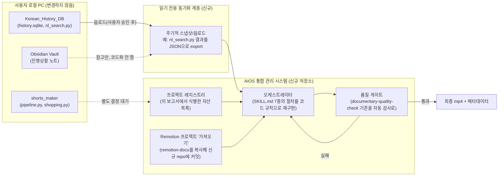

# 한국사 다큐멘터리/쇼츠 자동 제작 프로젝트 — AIOS 통합 조사 보고서

- 작성일: 2026-11-16
- 조사 범위: 현재 Claude Code 클라우드 세션(샌드박스)에서 접근 가능한 경로만. 사용자의 로컬 PC(Windows)는 이 세션에서 **접근 불가**이며, 해당 항목은 전부 "미확인"으로 표시했다.
- 원칙: 기존 파일 삭제/덮어쓰기 없음, 폴더 구조 변경 없음, 이 보고서 파일(`AIOS_INTEGRATION_PLAN.md`) 생성 외 어떤 파일도 수정하지 않음, 비용 발생/외부 서비스 호출 테스트는 실행하지 않고 사전 보고만 함.

---

## 1. 접근 가능한 작업 폴더와 기존 한국사 관련 시스템

이 세션에서 실제로 확인한 경로는 다음 네 종류뿐이다.

| 위치 | 내용 | 한국사 프로젝트 관련 여부 |
|---|---|---|
| `/home/user/lotto-quant-v3` (git 저장소, 이 보고서가 저장되는 곳) | 로또 번호 분석 Streamlit 앱(`lotto_quant_v3` 패키지). `AIOS_SYSTEM_AUDIT.md`(이전 조사 결과)도 여기 있음 | **없음** — 이전 `AIOS_SYSTEM_AUDIT.md`에서 이미 grep으로 확인됨 |
| `/tmp/.../scratchpad/` (세션 전용 임시 폴더) | 이번 Claude Code 세션 안에서 내가 직접 만든 한국사 다큐 제작물 전체(Python 스크립트, 지도 데이터, 렌더링된 mp4, 그리고 핵심인 `remotion-docu/` Remotion 프로젝트) | **있음 — 유일하게 실행 가능한 코드가 있는 곳** |
| `~/.claude/skills/synced/.../{history-research, historical-fact-check, documentary-storyboard, documentary-production, documentary-quality-check, shorts-context, youtube-auto}/SKILL.md` | Claude Code에게 "어떻게 작업할지" 알려주는 지침 문서 7개 | **있음 — 다만 코드가 아니라 지침서. 실제 DB·스크립트는 사용자의 로컬 PC에 있다고 적혀 있을 뿐, 이 샌드박스에는 없음** |
| `/home/claude`, `/home/ubuntu`, `/` 최상위 | 조사 완료. `/home/claude`는 Claude Code 인프라 설정(`.claude`, `.ssh`, `.npm`)뿐, `/home/ubuntu`는 빈 기본 계정 | **없음** |

**핵심 발견 1**: 사용자가 말한 "기존 한국사 다큐/쇼츠 자동 제작 프로젝트"는 이 클라우드 세션 기준으로 **세 갈래로 흩어져 있다.**

1. **사용자의 로컬 PC(Windows)에만 있는 것** — 이 세션에서는 경로 문자열만 보이고 실체는 **전혀 접근 불가**:
   - `C:\Korean_History_DB\` — 사료 DB(`history.sqlite`), 검색 스크립트(`nl_search.py`, `search.py`), Remotion 테스트(`C:\Korean_History_DB\video\remotion_test`)
   - Obsidian Vault `C:\Users\mb948\Documents\Obsidian Vault\Korean_History_Documentary\` — 진행상황 노트
   - `C:\Users\mb948\OneDrive\Desktop\...\shorts_maker\` — `shorts-context` 스킬이 가리키는 **별도의 쇼츠 자동화 시스템**(`pipeline.py` 42KB, `shopping.py` 75KB 등). 이번 조사에서 **처음 확인된 사실**로, 한국사 다큐 작업과는 별개의 기존 자동화 자산이다.
2. **이 클라우드 세션의 임시 작업공간(`/tmp/.../scratchpad/`)에만 있는 것** — 실제로 동작이 검증된 코드. 단, 이 폴더는 **영구 저장소가 아니다** (세션 재시작/정리 시 사라질 수 있음, git 저장소도 아님).
3. **Claude Code 스킬(SKILL.md)로만 있는 것** — 작업 절차·검증 기준·금지사항을 적어둔 지침 문서. 코드나 데이터 자체는 포함하지 않는다.

이 세 갈래가 지금 하나로 합쳐져 있지 않다는 것이 AIOS 통합 설계 시 가장 먼저 풀어야 할 문제다.

---

## 2. 기능별 조사 — DB / 검색엔진 / 시나리오 생성기 / 스토리보드 / 영상 생성기 / 음성·자막 처리

### 2-1. 한국사 원문 데이터베이스
- `history-research` SKILL.md에 따르면 `C:\Korean_History_DB\db\history.sqlite`에 조선왕조실록(1392~1863)·삼국사기·삼국유사 원문이 SQLite로 저장되어 있다고 기술됨.
- **미확인**: 이 세션에서는 이 파일의 존재, 스키마, 레코드 수를 전혀 검증할 수 없다. 사용자 PC 전용.

### 2-2. 검색 엔진
- `nl_search.py`(자연어 검색, `--json` 출력, `parse`/`grade`/`evidence`/`related_count` 필드 사용), `search.py`(한문 전문검색 FTS)로 기술됨. 둘 다 PowerShell에서 `..\.venv\Scripts\python.exe`로 실행.
- **미확인**: 코드 내용, 실제 동작 여부 모두 로컬 PC에만 있어 검증 불가.

### 2-3. 시나리오/대본 생성기
- `documentary-storyboard` SKILL.md: "사실/해석" 판정이 난 사실 카드만 입력으로 받아 훅 3초·65초 구성·장면표를 만드는 **절차**를 정의. 이것은 Claude가 그때그때 수행하는 작업 지침이며, 별도의 실행 코드(스크립트/프로그램)는 아니다.
- `youtube-auto` SKILL.md: 훅 21개 공식, 5항목 채점식(72점 이상 STRONG 등), 제목/썸네일 규칙을 정의한 범용 유튜브 대본 보조 지침(MIT, Jake Schincariol 저작 요약판). 한국사 전용이 아니라 일반 숏폼 전반에 쓰는 규칙.
- 이번 세션에서 실제로 쓴 `script.json` / `script_v2.json` / `script_v3.json`(scratchpad)은 이 절차를 따라 **내가 수작업으로 작성한 데이터 파일**이며, "생성기 프로그램"이 아니다. 즉 **자동 생성기는 아직 존재하지 않는다** — 매번 Claude가 절차를 보고 새로 작성.

### 2-4. 스토리보드
- 동일하게 `documentary-storyboard` SKILL.md는 지침일 뿐 프로그램이 아니다.
- scratchpad의 `timing.json`/`timing_v2.json`이 장면별 시작~끝 시각을 담은 실제 데이터이고, Remotion 프로젝트의 `src/data/episode.json`이 최종적으로 구조화된 장면표(스토리보드)다. **이 `episode.json` 스키마가 가장 구체적이고 재사용 가치가 높다** (장면 타입 5종: map/document/familyTree/tomb/summary, 각 타입별 필드 정의).

### 2-5. 영상 생성기
- **실제로 구현되어 동작 검증까지 끝난 것**: `/tmp/.../scratchpad/remotion-docu/` — Remotion(React/TypeScript) 프로젝트.
  - `src/Root.tsx`, `src/Video.tsx`가 `episode.json`을 읽어 장면을 합성(`<Sequence>`)하고 내레이션/음악 `<Audio>`를 믹싱.
  - 장면 컴포넌트 5개(`Scene1Map`, `Scene2Document`, `Scene3FamilyTree`, `Scene4Tomb`, `Scene5Summary`) 모두 TypeScript로 작성되어 있고, 공용 디자인 시스템 컴포넌트(`PaperCard`, `Pin`, `Caption`, `Tag`, `RedString`, `SceneCamera`, `ReenactmentTag`, `fonts`, `theme`)로 구성.
  - `out/documentary.mp4`(27.8MB), `out/documentary_v2.mp4`(28.1MB, 가장 최근 11/16 08:21 생성)로 **실제 렌더링 결과물이 디스크에 존재** — 이것이 "실제로 돌아간다"는 가장 강력한 증거다.
  - 폰트(TSI 테이블 제거), 지도 이미지(삼국시대 영역을 `world-atlas`+`shapely`로 가공), 내레이션/음악 mp3·wav가 `public/`에 포함.
- `package.json` 확인: `@remotion/cli`, `@remotion/renderer`, `remotion`, `react`/`react-dom` ^19, `typescript` ^7 — 모두 npm 레지스트리 표준 패키지(이 세션의 네트워크 allowlist로 설치 가능했던 것들). `node_modules` 626MB가 설치되어 있음.
- **미확인**: 사용자가 원래 의도했던 `C:\Korean_History_DB\video\remotion_test`(로컬 PC의 Remotion 테스트)는 이 `remotion-docu`와 동일한 것인지, 별개인지 전혀 알 수 없다. SKILL.md는 "설치·렌더 테스트 완료"라고만 적어 두었다.

### 2-6. 음성(TTS) 및 자막 처리
- **음성**: 이번 세션에서는 vidIQ MCP의 `vidiq_voiceover_generate`로 narration_v2/v3.mp3를 만들었다(유료 크레딧 소비). `documentary-production` SKILL.md는 원래 **Google Cloud TTS Chirp 3 HD**(남성, `ko-KR-Chirp3-HD-Charon`)를 1순위로 쓰고, GCP 예산 설정이 안 되어 있으면 `edge-tts`(무료, 남성 InJoon/Hyunsu) 대체를 사용자에게 물어보라고 적혀 있다. 즉 **이 샌드박스에서 실제로 쓴 음성 경로(vidIQ)는 원래 설계(GCP/edge-tts)와 다른, 세션 한정 대체 경로**다.
- **자막**: Remotion의 `Caption` 컴포넌트가 화면 자막을 렌더링하지만, 별도의 `.srt` 파일 생성·음성-자막 동기화 자동화 코드는 scratchpad에 없다(수작업으로 타이밍을 맞춤). `documentary-quality-check` SKILL.md는 "문장별 음성 길이(ffprobe)와 자막 구간 차이 0.3초 이내"를 검수 기준으로 두지만, 이를 자동으로 측정·보정하는 스크립트는 아직 존재하지 않는다.

---

## 3. 실제 구현 vs 계획만 — 종합 분류

| 구성요소 | 상태 | 근거 |
|---|---|---|
| Remotion 영상 합성 파이프라인 (장면 5종, 디자인 시스템, 폰트, 지도) | **실제 구현 + 실행 검증됨** | `out/*.mp4` 실파일 존재, 코드 직접 읽음 |
| `episode.json` 스토리보드 스키마 | **실제 구현** | 파일 존재·구조 확인 |
| FFmpeg 오디오 믹싱/인코딩 절차 (loudnorm, sidechaincompress, yuv420p 변환) | **실제 구현(세션 내 1회성 스크립트로)**, 재사용 가능한 모듈 형태는 아님 | scratchpad의 `assemble.py` 등 1회성 스크립트 |
| 한국사 사료 DB + 자연어 검색(`nl_search.py`/`search.py`) | **계획만 (사용자 PC, 미확인)** | SKILL.md 텍스트만 존재, 실체 미접근 |
| 시나리오/대본 "생성기" (자동 프로그램) | **계획만** — 실제로는 매번 Claude가 SKILL.md 절차를 따라 수작업 작성 | 자동화 스크립트 없음, `script_v*.json`은 결과물일 뿐 |
| 사실 검증(historical-fact-check) 자동화 | **계획만** — SQLite 대조 "절차"만 정의, 실행 코드 없음 | SKILL.md 텍스트 |
| 품질 검수(documentary-quality-check) 자동화 | **부분 실행됨(세션 내 수동 ffprobe/ffmpeg 명령), 자동 스크립트화는 안 됨** | 세션 중 실제로 ffprobe 호출한 기록 있음(이전 대화), 그러나 재사용 가능한 스크립트 파일로 저장되진 않음 |
| 쇼츠 자동화 시스템(`shorts_maker`, `pipeline.py`/`shopping.py`) | **계획만(이 세션 기준) — 사용자 PC 전용, 완전히 미확인** | `shorts-context` SKILL.md에서만 존재 확인, 코드 접근 불가 |
| GCP TTS(Chirp3 HD)/라이선스 음악 자산 관리 | **계획만** — 이 세션에서는 대신 vidIQ 유료 TTS로 대체 실행 | SKILL.md 원안과 실제 세션 실행 경로가 다름 |

---

## 4. 실행 가능성 검증 — 안전하게 한 것 vs 비용이 발생해 실행하지 않은 것

### 4-1. 이미 안전하게(비용 없이) 검증된 것
- **Remotion 렌더링 전체 파이프라인**: 이번 세션에서 실제로 `npx remotion render`를 로컬 Chromium으로 실행해 `out/documentary.mp4`(69.2초), `out/documentary_v2.mp4`를 생성 완료. 외부 API 호출 없음(폰트·이미지·오디오는 모두 로컬 파일 참조). → **재실행 불필요, 이미 충분한 증거.**
- 위 파일들의 존재(`ls -la out/`)만 지금 다시 확인했다(비용 없음, 실행 아님, 단순 파일 목록 조회).

### 4-2. 비용 발생/외부 서비스 호출이 필요해 **실행하지 않고 사전 보고만 하는 것**
아래는 실행하면 비용(크레딧) 또는 외부 네트워크 호출이 발생하므로 **이번 조사에서 실행하지 않았다.** AIOS 통합 단계에서 필요해지면 그때 개별적으로 사용자 승인을 받고 실행해야 한다.

| 항목 | 비용/외부호출 성격 |
|---|---|
| `vidiq_voiceover_generate` 재호출(내레이션 재생성) | vidIQ 크레딧 소비 |
| `vidiq_generate_music`(배경음악 생성) | vidIQ 크레딧 소비 |
| Canva `upload-asset-from-url`/`generate-image` | 외부 이미지 호스트 호출 + Canva 크레딧 |
| Google Cloud TTS Chirp 3 HD 실제 호출 | GCP 과금(프로젝트 설정 여부부터 미확인) |
| `C:\Korean_History_DB`의 `nl_search.py`/`search.py` 실행 | 로컬 PC에서만 가능 — 이 세션에선 네트워크·파일 접근 자체가 안 되므로 "실행 불가"가 아니라 "이 환경에서 호출 경로가 없음" |
| `shorts_maker/pipeline.py` 등 원격 기기 도구(Desktop Commander) 경유 실행 | 사용자의 실제 PC에 명령을 보내는 행위이므로 외부(사용자 환경) 영향 — 사전 승인 필요 |

→ 이 6개 항목은 AIOS 설계·테스트 단계에서 "실행해도 될지"를 사용자에게 개별적으로 먼저 물어야 한다.

---

## 5. AIOS 재사용 가능 vs 신규 개발 필요

### 재사용 가능 (그대로 또는 거의 그대로)
1. **Remotion 프로젝트 전체 구조** (`remotion-docu/`) — 장면 타입 시스템(`types.ts`), 디자인 시스템 컴포넌트, 폰트 처리, 지도 생성 로직. AIOS의 "영상 생성" 모듈로 그대로 흡수 가능.
2. **`episode.json` 스키마** — 시나리오→영상 변환의 중간 표현(intermediate representation)으로 AIOS 파이프라인의 계약(contract)으로 삼을 수 있음.
3. **7개 SKILL.md의 절차·검증 기준 자체** (사료 등급 판정 기준, 사실/해석/추정/충돌 구분, 품질 검수 체크리스트, 훅 채점식) — 이것들은 코드가 아니라 "규칙"이므로 AIOS의 오케스트레이션 로직에 그대로 규칙으로 옮겨 쓸 수 있음. 특히 `historical-fact-check`의 사실/해석/추정/충돌 4단계 판정과 `documentary-quality-check`의 ffprobe 기반 정량 검수 기준은 AIOS에서 "자동 게이트(gate)"로 구현하기 좋은 형태.
4. FFmpeg 최종 인코딩 명령어(이 세션에서 검증된 `-c:v libx264 -pix_fmt yuv420p ... -movflags +faststart` 조합) — AIOS의 "최종 출력" 단계에 그대로 재사용 가능.

### 신규 개발 필요
1. **DB/검색엔진 연동 계층**: 로컬 `history.sqlite` + `nl_search.py`를 AIOS가 호출할 수 있는 형태(API 서버, 혹은 동기화된 읽기 전용 복제본)로 만드는 작업. 현재는 "사용자 PC의 PowerShell에서만 실행 가능"이라 자동화 파이프라인에 넣을 수 없음.
2. **시나리오/대본 자동 생성기**: 지금은 SKILL.md 절차를 Claude가 매번 수작업으로 따르는 방식. AIOS라면 이걸 "입력(사실 카드) → 출력(장면표 JSON)"을 만드는 결정적 모듈(또는 최소한 재사용 가능한 프롬프트 템플릿+스키마 검증기)로 코드화해야 함.
3. **사실 검증 자동화**: SQLite 조회 + 판정 로직을 실제 스크립트/함수로 구현 필요(지금은 SKILL.md의 "절차 설명"뿐).
4. **음성(TTS) 경로 통합**: GCP Chirp3 HD와 vidIQ 유료 TTS 중 AIOS가 기본으로 쓸 경로를 하나로 확정하고, 실패 시 대체(edge-tts) 전환 로직을 코드화.
5. **자막-음성 동기화 자동 검증**: `documentary-quality-check`의 "0.3초 이내 차이" 기준을 실제로 ffprobe 결과와 자막 타이밍을 비교해 통과/실패를 리턴하는 스크립트로 구현.
6. **`shorts_maker`(쇼핑/뉴스 쇼츠 자동화)와의 통합 여부 결정**: 이번 조사로 처음 드러난, 한국사 다큐와는 별개인 기존 자동화 자산. AIOS가 두 파이프라인(한국사 다큐 vs 범용 쇼츠)을 하나의 시스템으로 묶을지, 별도로 유지할지 사용자가 먼저 결정해야 함.
7. **세션 영속성**: 지금 유일하게 동작하는 Remotion 프로젝트가 **임시 scratchpad**(재시작 시 소실 가능)에 있다는 것 자체가 신규 작업 대상이다 — git 저장소로 옮기거나 사용자 PC로 내려받아야 영구 자산이 된다.

---

## 6. 기존 프로젝트를 변경하지 않고 AIOS와 연결하는 가장 안전한 구조

### 설계 원칙
- 기존 산출물(`remotion-docu/`, SKILL.md 7개, 사용자 PC의 DB/Obsidian/`shorts_maker`)은 **읽기 전용 소스**로만 취급한다.
- AIOS는 기존 코드를 **복사해서 자신의 저장소 안에 새 버전으로 들여오는 방식**(import, 원본은 그대로 둠)을 쓴다. 원본 폴더를 직접 참조·수정하지 않는다.
- 사용자 PC 자원(DB, shorts_maker)에 대한 접근은 항상 **읽기 전용 API/스냅샷 계층**을 하나 두어, AIOS가 PowerShell이나 파일시스템을 직접 건드리지 않게 한다.

### 핵심 안전장치
1. **원본 보존**: `remotion-docu/`는 scratchpad에서 "복사"만 해서 AIOS 쪽 git 저장소에 새로 커밋한다. 원본 scratchpad 폴더는 손대지 않는다(어차피 임시 폴더라 언젠가 사라지므로, 복사가 곧 "구조 변경 없는 승격"이 된다).
2. **DB는 절대 직접 연결하지 않음**: `history.sqlite`를 읍로드할 때도 읍로드 시점에 사용자가 매번 승인하고, AIOS는 그 결과(JSON 등)만 받는다. SKILL.md들이 공통으로 명시한 "원본 DB 수정 금지"를 그대로 지키는 구조.
3. **`shorts_maker`는 통합 범위에서 일단 분리**: 이번 조사로 처음 발견된 자산이라 영향 범위를 아직 모른다. AIOS 1단계에는 포함하지 않고, 사용자 결정 이후 별도 트랙으로 붙인다.
4. **비용 발생 호출은 전부 AIOS의 "승인 필요" 노드로 표시**: 4-2절의 6개 항목은 오케스트레이터 설계 시 자동 실행하지 않고 사용자 승인 스텝을 거치게 한다.

---

## 7. 단계별 구축 계획과 성공 기준

| 단계 | 내용 | 성공 기준 |
|---|---|---|
| **0단계 — 자산 동결/백업** | `remotion-docu/`를 scratchpad에서 벗어난 영구 저장소(사용자 PC 또는 새 git repo)로 **복사**(원본 비변경) | 복사본에서 `npx remotion render`가 추가 설정 없이 성공 |
| **1단계 — 레지스트리 구축** | 이 보고서의 표(3절)를 AIOS의 "자산 레지스트리" 데이터로 코드화(실제 구현/계획만/미확인 태그 유지) | 레지스트리 조회 시 각 자산의 상태·위치·의존성이 한눈에 나옴 |
| **2단계 — 읍로드 계층** | `nl_search.py` 결과를 JSON으로 내보내 AIOS가 읍로드 받는 최소 연동(사용자 PC에서 수동 실행 → 파일 전달) | 실제 사료 검색 결과 1건이 AIOS 쪽 레지스트리에 JSON으로 들어오는 것 확인 |
| **3단계 — 시나리오 생성기 코드화** | `documentary-storyboard`/`historical-fact-check` 절차를 스키마 검증기 + 프롬프트 템플릿으로 구현 | 사실 카드 입력 → `episode.json` 호환 스토리보드 출력까지 수동 개입 없이 1회 성공 |
| **4단계 — 영상 생성 연결** | 3단계 출력을 그대로 `remotion-docu`(복사본)의 `episode.json`에 꽂아 렌더링 | 사람이 추가로 JSON을 손대지 않고 mp4가 나옴 |
| **5단계 — 품질 게이트 자동화** | `documentary-quality-check`의 ffprobe/세이프에어리어 기준을 자동 스크립트로 구현 | 기준 미달 영상은 "실패"로 자동 반려, 기준 통과 영상만 "완성"으로 표시 |
| **6단계 — 음성/비용 경로 확정 + 승인 플로우** | GCP TTS vs 대체 경로 결정, 4-2절 6개 비용 항목에 대한 승인 UI/프로세스 추가 | 비용 발생 단계에서 자동 실행되지 않고 반드시 승인 기록이 남음 |
| **7단계 — `shorts_maker` 통합 여부 결정 및 (승인 시) 연동** | 사용자가 범용 쇼츠 자동화와 한국사 다큐 파이프라인 통합 여부 결정 | 통합하지 않기로 하면 레지스트리에 "별도 운영"으로 명시, 통합하면 0~6단계와 동일한 절차 반복 |

---

## 미확인 항목 요약 (추측 금지, 전부 명시)

- `C:\Korean_History_DB\db\history.sqlite`의 실제 존재·스키마·레코드 수
- `nl_search.py` / `search.py`의 실제 코드 내용과 동작 여부
- `C:\Korean_History_DB\video\remotion_test`가 이 세션의 `remotion-docu`와 같은 것인지 여부
- Obsidian Vault 노트(`01_현재_진행상황.md`, `05_다음_작업.md`, `06_개발환경_도구.md`)의 실제 내용
- `shorts_maker`(`pipeline.py`, `shopping.py`)의 실제 코드, 완성도, 기존 운영 여부
- GCP 프로젝트/예산 상한이 실제로 설정되어 있는지 여부
- `C:\Korean_History_DB\video\music\`의 라이선스 음악 파일 실존 여부

---

## 저장 경로
`/home/user/lotto-quant-v3/AIOS_INTEGRATION_PLAN.md`
