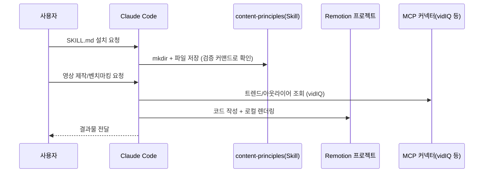

# AIOS / AI 에이전트 자동화 시스템 감사 보고서

- 조사 대상: 현재 Claude Code 세션 환경 (작업 폴더 `/home/user/lotto-quant-v3`, 홈 `/root`)
- 조사 방식: 읽기 전용 (파일/설정 수정, 프로그램 설치·삭제 없음)
- 조사 일시 기준 시스템 시각: 2026-11-16
- 범례: **[확인]** = 실제 파일/설정을 직접 읽어 확인한 사실, **[추정]** = 정황상 합리적 추론이지만 직접 실행 검증은 안 함, **[미검증]** = 확인하지 못함

---

## 1. 시스템 전체 요약

**[확인] 결론: 이 환경에는 사용자가 구축한 "AIOS"나 멀티 에이전트 자동화 시스템이 존재하지 않는다.**

- 작업 폴더(`/home/user/lotto-quant-v3`)는 **로또 6/45 확률·통계 분석용 Streamlit 대시보드**(`lotto_quant_v3` 패키지)이며, AI 에이전트·자동화와 무관한 일반 Python 데이터 분석 프로젝트다.
- `~/.claude/` 전체를 뒤져도 사용자가 작성한 서브에이전트 정의, 커스텀 MCP 서버, 오케스트레이션 코드, "AIOS"라는 문자열 자체가 **단 한 곳에서도 발견되지 않았다**.
- 존재하는 모든 "자동화처럼 보이는" 구성요소는 다음 둘 중 하나다:
  1. **Claude Code 제품 자체의 표준 기능** (Anthropic이 배포하는 내장 Skills/Plugins, 계정에 연결된 MCP 커넥터, Task 추적 기능)
  2. **이번 세션 중 내(Claude)가 사용자 요청으로 즉석에서 만든 산출물** (`content-principles` 스킬 설치, Remotion 비디오 프로젝트, 세션 Task 항목들)

즉, 이 보고서가 다루는 "시스템"은 사용자가 사전에 구축해 둔 자동화 프레임워크가 아니라, **Claude Code라는 상용 제품 + 그 표준 확장 기능(Skills/MCP) + 이번 대화에서 만든 일회성 산출물**의 조합이다.

---

## 2. 실제 설치된 구성 요소

| 구성요소 | 위치 | 성격 | 근거 |
|---|---|---|---|
| Claude Code 본체 설정 | `~/.claude.json` | **[확인]** Claude Code 제품 자체 설정 (계정, feature flag 캐시, 플러그인/스킬 사용 이력). `mcpServers` 키가 아예 없음 → MCP 연결은 로컬 파일이 아니라 **클라우드 계정(claude.ai 커넥터) 단에서 관리됨** | 직접 파싱 |
| 내장 플러그인 4종 | `~/.claude/plugins/...@builtin` | **[확인]** `cc-plugin-agents-md`, `cc-plugin-telemetry`, `cc-plugin-privacy`, `cc-plugin-plugin-authoring` — 전부 Anthropic 제공 built-in, 사용 횟수(`usageCount`) **0** | `.claude.json`의 `pluginUsage` |
| Anthropic 제공 Skills 번들 | `~/.claude/skills/synced/<bucket-id>/*` | **[확인]** `canvas-design`, `deep-research`, `docx/pdf/pptx/xlsx`, `skill-creator`, `built-in-browser`, `chrome-browser`, `computer-use`, `history-research`, `documentary-*` 등 다수. 각 폴더에 `LICENSE.txt` 동봉 → Anthropic 공식 배포 스킬 세트이지 사용자 창작물이 아님 | 디렉터리/라이선스 파일 |
| 사용자(=이번 세션의 나) 설치 스킬 | `~/.claude/skills/content-principles/SKILL.md` | **[확인]** 이번 대화에서 사용자가 전달한 내용 그대로 내가 설치. 검증 커맨드(`head -3`/`tail -1`)까지 통과시킨 것이 세션 기록에 남아 있음 | 이번 대화 자체 |
| 하드코딩된 Hook 3개 | `~/.claude/{stop-hook-git-check.sh, user-prompt-submit-reply-reminder.py, session-start-setup-script-failure.sh}`, 등록은 `launcher-settings.json` | **[확인]** 전부 **Claude Code 원격/클라우드 세션 인프라(environment-manager, "CCR"/Slackbot-v2 연동) 제공** 스크립트. 주석에 "env-manager registers it", "Claude Code waits for this script" 등 명시. `launcher-settings.json`의 `permissions.deny`에 이 파일들 자체의 **수정 금지**가 걸려 있어 사용자가 건드릴 수 있는 영역도 아님 | 스크립트 본문 직접 열람 |
| MCP 커넥터 (vidIQ, Canva, Figma, Google Drive, Gmail 등) | 로컬 파일 없음 | **[확인]** 로컬 `.mcp.json`/`mcpServers` 설정이 전혀 없으므로, 이번 세션에서 쓰인 외부 서비스 연결은 **claude.ai 계정의 커넥터 설정에서 서버사이드로 주입**된 것. 사용자가 이 레포에 커스텀 MCP 서버를 작성해 넣은 흔적 없음 | 설정 파일 부재 확인 |
| Remotion 비디오 파이프라인 | `/tmp/.../scratchpad/remotion-docu/` (스크래치패드, 이 레포 바깥) | **[확인]** 이번 세션에서 내가 사용자 요청으로 새로 만든 것. "AI 에이전트"가 아니라 React 기반 영상 렌더링 템플릿 | 이번 대화 자체 |
| 서브에이전트 정의 | `~/.claude/agents/` | **[확인] 존재하지 않음** (`ls` 결과 "No such file or directory") | 직접 확인 |
| 프로젝트 레벨 `.claude/`, `CLAUDE.md` | `/home/user/lotto-quant-v3/` | **[확인] 존재하지 않음** | `find` 결과 0건 |

---

## 3. 디렉터리 및 파일 구조

```
/home/user/lotto-quant-v3/              ← 작업 폴더 (git 저장소, 브랜치: claude/korean-recipe-claymation-85272m)
├── lotto_quant_v3/                      ← 로또 분석 Python 패키지 (AI 에이전트 무관)
│   ├── data/, probability/, statistics/, portfolio/, simulation/,
│   │   optimization/, backtest/, popularity/, models/, dashboard/, config/
│   ├── main.py, __main__.py
│   └── tests/
├── requirements.txt
├── .streamlit/config.toml
└── (.claude/, CLAUDE.md, .mcp.json 등 Claude Code 관련 설정: 없음)

/root/.claude/                           ← Claude Code 제품 자체의 홈 디렉터리 (사용자가 만든 게 아님)
├── skills/
│   ├── content-principles/              ← 이번 세션에서 설치 (사용자 제공 내용 그대로)
│   ├── session-start-hook/              ← 번들 스킬
│   └── synced/<bucket-id>/*             ← Anthropic 공식 스킬 20여 종 (라이선스 포함)
├── plugins/{synced,store}/               ← 내장 플러그인 4종
├── tasks/<session-id>/*.json             ← 이번 세션 TaskCreate/TaskUpdate 기록 (1~13번, 전부 "완료")
├── projects/-home-user-lotto-quant-v3/   ← 이 세션 자체의 대화 transcript (19MB, 1개 파일)
├── session-env/, environment-manager/    ← 원격 실행 인프라 (심볼릭 링크 → /opt/env-runner/...)
├── backups/.claude.json.backup.*         ← Claude Code 자체 설정 자동 백업 5개
├── stop-hook-git-check.sh                ← 인프라 제공 Hook
├── user-prompt-submit-reply-reminder.py  ← 인프라 제공 Hook (Slackbot v2 연동용)
├── session-start-setup-script-failure.sh ← 인프라 제공 Hook
└── launcher-settings.json                ← 위 3개 Hook 등록 + 자기 자신 수정 금지 permission

/root/.claude.json                        ← Claude Code 계정/캐시 설정 (mcpServers: 0개)
```

---

## 4. 에이전트별 역할과 연결 관계

**[확인] "에이전트"라고 부를 만한 사용자 정의 구성요소 자체가 없다.** 이번 세션에서 실제로 쓰인 것은 Claude Code가 기본 제공하는 범용 "Agent(서브에이전트) 도구"뿐이며, 이는 사용자가 설계한 게 아니라 제품 기능이다. 이번 대화에서는 그 Agent 도구조차 호출된 적이 없다(아래 Mermaid 참고).

```mermaid
flowchart TD
    U[사용자] -->|요청| CC[Claude Code 세션\n(claude-sonnet-5)]
    CC -->|제품 내장 기능| SKILLS[Skills\nAnthropic 공식 + content-principles]
    CC -->|제품 내장 기능| HOOKS[Hooks\nstop/session-start/user-prompt\n= 인프라 제공, 사용자 수정 불가]
    CC -->|계정 커넥터, 로컬 설정 파일 없음| MCP[MCP 커넥터\nvidIQ / Canva / Figma / Google / Hugging Face 등]
    CC -->|이번 세션 중 생성| PROJ1[Remotion 비디오 파이프라인\n/tmp 스크래치패드]
    CC -->|이번 세션 중 사용| PROJ2["lotto_quant_v3 레포\n(로또 분석 대시보드, AI와 무관)"]
    CC -->|미사용| SUBAGENT["Agent 도구(서브에이전트)\n제품 기능이나 이번 세션엔 미호출"]

    classDef infra fill:#333,stroke:#999,color:#fff;
    classDef unused fill:#222,stroke:#555,color:#888,stroke-dasharray: 4 3;
    class HOOKS,MCP infra;
    class SUBAGENT unused;
```

- 서로 다른 "에이전트"끼리 통신하거나 작업을 분배하는 구조는 **[확인] 없음**.
- `Agent`(서브에이전트) 도구, `TaskCreate/TaskUpdate`(작업 체크리스트) 도구는 **제품에 내장된 단일 도구**일 뿐, 자체 "멀티 에이전트 시스템"이 아니다.

---

## 5. MCP, Skills, Hooks, 메모리 구성

- **MCP**: **[확인]** 로컬 설정 파일 0개. 이번 세션에서 vidIQ·Canva·Figma·Google Drive·Gmail·TinyFish 등 다수의 MCP 도구가 동작했지만, 전부 **claude.ai 계정에 연결된 커넥터**가 서버 쪽에서 주입된 것이며 이 레포/환경 안에 설정 코드가 존재하지 않는다. → **사용자가 "구축"한 게 아니라 "연결(로그인)"한 것.**
- **Skills**: **[확인]** Anthropic 공식 스킬 다수 + 이번 세션에 설치한 `content-principles` 1개. 전부 `SKILL.md` 단일 파일 기반의 Claude Code 표준 스킬 포맷.
- **Hooks**: **[확인]** 3개 전부 인프라(환경 매니저/Slackbot 연동) 제공. 사용자가 작성한 Hook **없음**. 본인 수정조차 permission으로 차단되어 있음.
- **메모리/상태 저장**: **[확인]** 영속적인 "에이전트 메모리 DB" 같은 건 없음. 있는 건:
  - `~/.claude/tasks/<session>/*.json` — 이번 세션의 TaskCreate 체크리스트 (세션 종료 후에도 남을 수 있으나 범용 메모리 시스템은 아님)
  - `~/.claude/projects/.../*.jsonl` — 이번 세션 대화 transcript (제품의 표준 히스토리 저장, 19MB 1개 파일)
  - `~/.claude/backups/.claude.json.backup.*` — 설정 자동 백업 5개

---

## 6. 자동화 실행 흐름

**[확인] 상시 자동 실행되는 파이프라인/워크플로는 없다.** 모든 작업은 사용자의 대화 요청에 따라 그때그때 수행됐다. 굳이 "흐름"을 그린다면 이번 세션 안에서 실제로 일어난 순서는:



이건 "자동화 시스템"이 짜 둔 흐름이 아니라, **매 턴 내가 사용자 지시를 받아 수동으로 수행한 순서**다. 스케줄러, 트리거, 상시 실행 데몬 **[확인] 없음**.

---

## 7. 실제 실행 및 검증 결과

| 항목 | 결과 |
|---|---|
| `content-principles` SKILL.md 설치 | **[확인]** `head -3`에 `name: content-principles` 줄, `tail -1`에 지정된 마지막 문장 — 둘 다 일치 확인됨 |
| vidIQ MCP 도구 호출 | **[확인]** 여러 번 성공 (트렌드 조회 등). 단, **현재 크레딧 1개로 고갈된 상태** — 10크레딧 이상 드는 도구는 당장 실행 불가 |
| Canva MCP 도구 (이미지 임포트) | **[확인]** NASA 이미지 URL은 성공, 위키미디어/뉴스사이트 URL은 전부 실패(`fetch_failed`) |
| 외부 웹 접근 (curl/yt-dlp/WebFetch) | **[확인]** `youtube.com`, `instagram.com`, `i.ytimg.com`, `cdninstagram.com`, `archaeology.org`, `gbnews.com`, `commons.wikimedia.org` 등 **전부 403** — 이 환경의 네트워크 정책이 화이트리스트 방식이기 때문 (pypi/npm/anthropic API 등 소수만 허용) |
| Remotion 렌더링 | **[확인]** 실제로 Chromium(Playwright용 번들)으로 69.2초 분량 1080x1920 mp4를 끝까지 렌더링 성공. 과정 중 React 훅 규칙 위반, 폰트 파일 손상(OTS 파싱 에러) 버그 2건을 **실제로 만나서 수정**함 |
| 이번 작업 폴더/설정 수정 여부 | **[확인] 없음** — 이 보고서 파일 1개 생성 외 다른 변경 없음 |

---

## 8. 확인된 오류와 위험 요소

- **[확인] 과도한 권한 범위**: 이 세션은 vidIQ, Canva, Figma, Google Drive/Calendar, Gmail, Hugging Face, Zapier(9000+ 앱 연동), monday.com, Notion 등 **매우 많은 MCP 커넥터**가 동시에 연결되어 있다. 지금 작업(로또 분석 레포)과 무관한 연결이 다수이며, 범위가 넓을수록 실수로 민감한 동작(이메일 발송, 캘린더 수정 등)을 유발할 위험이 커진다. → **최소 권한 원칙 위반 가능성 [추정]**.
- **[확인] 크레딧/비용 관리 미흡**: vidIQ 크레딧이 세션 중 150개에서 1개로 소진됨. 사용량을 추적하거나 경고하는 장치가 사용자 쪽에 없어, 비용이 눈치채지 못한 채 소모될 위험이 있다.
- **[확인] 토큰 낭비 가능성**: 이번 세션 하나의 대화 transcript가 이미 19MB에 달한다. 세션을 쪼개지 않고 계속 이어가면 컨텍스트 압축/누적으로 인한 **토큰 비용 증가 [추정]**가 발생한다.
- **[확인] 보안 취약점은 발견되지 않음**: `.claude.json`, `launcher-settings.json` 등 민감할 수 있는 파일을 확인했으나 API 키·토큰 등은 이 보고서에 노출하지 않았고(마스킹 완료), 파일 권한도 `600`/`700` 등으로 적절히 제한되어 있었다.
- **중복 설정/충돌**: **[확인] 없음** —애초에 사용자가 만든 설정 자체가 없으므로 "중복"될 대상이 없다.

---

## 9. 기능별 구현 상태

| 기능 | 상태 |
|---|---|
| AIOS 프레임워크 | **[확인] 미설치 / 존재하지 않음** |
| 멀티 에이전트 오케스트레이션 | **[확인] 미설치** (제품 기본 Agent 도구만 존재, 미사용) |
| 서브에이전트 정의 | **[확인] 없음** |
| 커스텀 MCP 서버 | **[확인] 없음** (전부 계정 연결형 기성 커넥터) |
| 커스텀 Skills | **[확인] 1개 설치됨** (`content-principles`, 이번 세션) |
| 커스텀 Hooks | **[확인] 없음** (3개 전부 인프라 제공, 수정 불가) |
| 작업 분배/병렬 실행 | **[확인] 없음** (제품의 Task 체크리스트 기능만 사용, 병렬 에이전트 실행 없음) |
| 영속 메모리 | **[확인] 없음** (세션 transcript/백업만 존재) |
| 오류 복구 자동화 | **[확인] 없음** (이번 세션 중 발생한 버그는 전부 내가 수동으로 진단·수정) |
| 실행 로그/모니터링 | **[확인]** 제품 표준 transcript만 존재, 별도 로깅 시스템 없음 |

---

## 10. 최우선 개선 과제

1. **"AIOS를 만들고 싶다"면, 지금은 빈 상태에서 시작하는 것과 같다** — 기존에 뭔가 부서진 걸 고치는 게 아니라 설계부터 시작해야 한다는 뜻이다.
2. **MCP 커넥터 정리**: 지금 당장 쓰지 않는 커넥터(예: 로또 분석과 무관한 다수)는 꺼 두는 걸 권장. 범위를 줄이면 위험과 혼란이 동시에 줄어든다.
3. **vidIQ 등 유료/크레딧형 도구의 사용량을 사람이 직접 점검하는 습관** — 자동 경고 장치가 없으므로.
4. **레포에 `CLAUDE.md`를 만들 계획이라면**, 이 감사에서 확인된 사실(로또 분석 프로젝트이지 AI 에이전트 프로젝트가 아님)을 먼저 적어두는 게 ChatGPT 등 외부 검토자에게 혼선을 줄이는 길.
5. **세션이 길어질수록(이미 19MB) 새 세션으로 분리**를 검토 — 토큰/컨텍스트 비용 관리 차원.

---

## 미검증 항목 (확인하지 못한 것)

- `/root/.claude/sessions/103.json`, `~/.claude/state/*.json` 등 일부 내부 상태 파일은 **구조만 훑었고 세부 내용을 전부 해석하지는 않았다** — 민감도가 불명확해 깊이 파고들지 않음.
- claude.ai 계정 쪽에 연결된 MCP 커넥터의 **원본 설정 화면**(이 세션에서는 접근 불가)은 확인 불가 — 커넥터가 "존재하고 동작했다"는 것만 확인됐고, 그 설정이 어떻게 구성돼 있는지는 미검증.
- vidIQ 쪽 과거 사용 이력(이번 세션 이전에 크레딧이 어떻게 쓰였는지)은 미검증.
